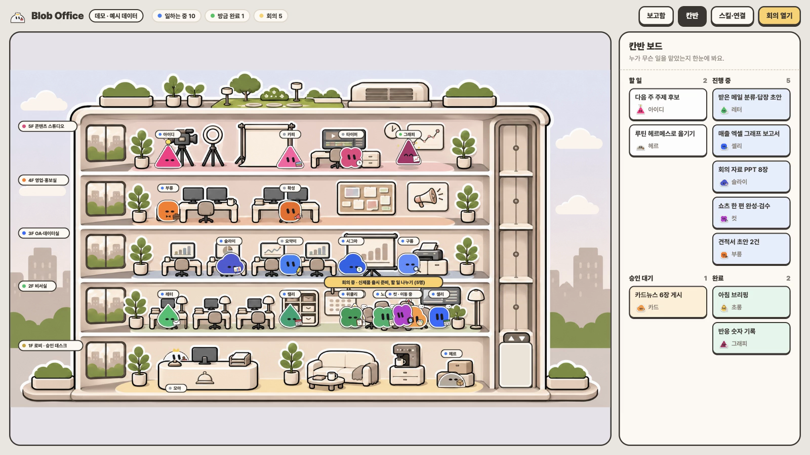
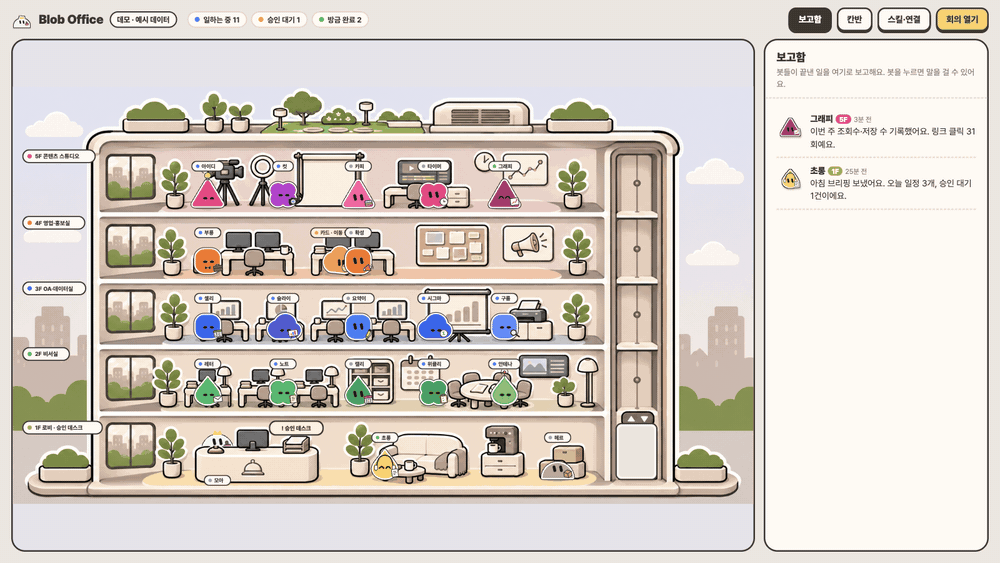
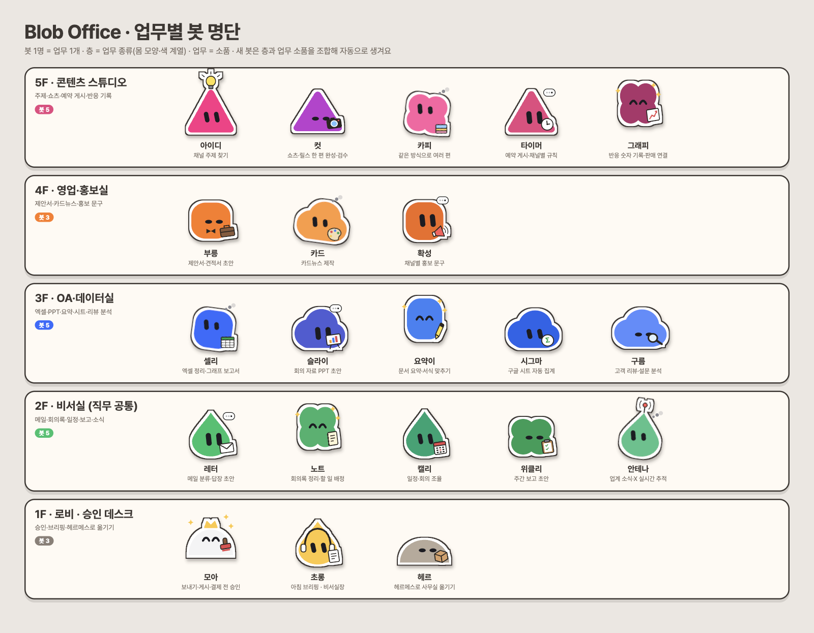

<p align="center"></p>

<p align="center"><a href="README.md">English</a> · <b>한국어</b></p>

# Blob Office

내 컴퓨터의 [Hermes Agent](https://github.com/NousResearch/hermes-agent) 봇들을, 층마다 다른 일을 하는 건물 속 말랑한 블롭 직원으로 보여 주는 화면이에요.



- 프로필 하나가 봇 한 명이에요. 봇이 하는 일에 따라 층이 정해지고, 층마다 몸 모양·색이, 일마다 손에 든 소품이 달라요.
- 봇은 실제로 걸어 다녀요. 승인이 필요하면 엘리베이터를 타고 1층 승인 데스크로 내려가고, 회의가 열리면 2층 회의 테이블로 모여요.
- 봇을 누르면 바로 말을 걸 수 있고, 「진행해 주세요」나 「하지 마세요」로 승인해요.
- 보고함, 칸반 보드, 층별 스킬·연결 도구도 한 화면에서 봐요.

## 층 구성

| 층 | 하는 일 | 예시 봇 |
|---|---|---|
| 5F 콘텐츠 스튜디오 | 주제 찾기, 쇼츠·릴스, 예약 게시, 반응 기록 | 아이디 · 컷 · 카피 · 타이머 · 그래피 |
| 4F 영업·홍보실 | 제안서·견적서, 카드뉴스, 홍보 문구 | 부릉 · 카드 · 확성 |
| 3F OA·데이터실 | 엑셀·그래프, PPT, 문서 요약, 시트 집계, 리뷰 분석 | 셀리 · 슬라이 · 요약이 · 시그마 · 구름 |
| 2F 비서실 | 메일, 회의록, 일정, 주간 보고, 업계 소식 | 레터 · 노트 · 캘리 · 위클리 · 안테나 |
| 1F 로비 · 승인 데스크 | 승인, 아침 브리핑, 헤르메스로 옮기기 | 모아 · 초롱 · 헤르 |



## 1. 먼저 데모로 보기 (1분)

[Node.js](https://nodejs.org) 20 이상이 필요해요.

```bash
git clone https://github.com/dingcodingco/hermes-blob-office
cd hermes-blob-office
node bin/blob-office.js
```

브라우저에서 http://127.0.0.1:4300 을 열어요. 데모는 예시 데이터라서 헤르메스가 없어도 돼요. 화면 위에 「데모 · 예시 데이터」라고 표시되고, 봇들이 알아서 일을 끝내고, 새 일을 시작하고, 가끔 승인을 받으러 내려와요.

## 2. 내 헤르메스와 연결하기 (키 없이)

헤르메스가 설치된 컴퓨터에서 이렇게 실행해요.

```bash
node bin/blob-office.js --hermes
```

| 화면 | 읽는 곳 |
|---|---|
| 봇(프로필)과 켜짐·꺼짐 | `hermes profile list` |
| 칸반 보드 | `hermes kanban list --json` |
| 스킬 | `hermes -p <프로필> skills list` |

헤르메스에 있는 프로필이 모두 봇으로 나와요. 15초마다 다시 읽어요.

## 3. 말 걸기 켜기 (키 필요)

말을 걸고 승인 버튼을 쓰려면 헤르메스의 API 서버를 켜야 해요. 키는 직접 만들어서 직접 넣어요.

1. 키를 하나 만들어요. 16자 이상이어야 헤르메스가 받아 줘요.
   ```bash
   openssl rand -hex 32
   ```
2. `~/.hermes/.env` 파일 맨 아래에 두 줄을 넣어요. `<키>` 자리에 1번에서 나온 값을 붙여요.
   ```bash
   API_SERVER_ENABLED=true
   API_SERVER_KEY=<키>
   ```
3. 게이트웨이를 다시 켜요: `hermes gateway restart`
4. 이 폴더에서 `.env.example` 을 `.env` 로 복사하고, `HERMES_API_KEY=` 뒤에 같은 키를 붙여요.
5. `node bin/blob-office.js --hermes` 로 다시 실행해요. 위쪽 배지가 「헤르메스 연결됨」이면 끝이에요.

다른 프로필 봇에게도 말을 걸려면, 그 프로필의 `~/.hermes/profiles/<프로필>/.env` 에도 `API_SERVER_KEY` 를 넣고, 이 폴더 `.env` 에 `HERMES_API_KEY_<프로필 이름 대문자>=` 로 같은 값을 넣어요([공식 문서](https://hermes-agent.nousresearch.com/docs/user-guide/features/api-server) 「Multi-profile routing」).

> API 서버 키가 있으면 그 봇에게 터미널 명령까지 시킬 수 있어요. 키는 남에게 보여 주지 말고, `.env` 는 깃허브에 올리지 마세요(`.gitignore` 에 들어 있어요).

## 4. 봇 이름·층·소품 바꾸기

`office.config.json` 의 `agents` 에 프로필마다 한 줄씩 적어요.

```json
{ "id": "card", "name": "카드", "profile": "cardnews", "job": "카드뉴스 제작" }
```

- `profile` 은 헤르메스 프로필 이름이에요.
- 층은 `job`·`name`·`profile` 에 든 낱말로 정해져요. 예를 들어 「쇼츠」「릴스」는 5F, 「견적」「카드뉴스」는 4F, 「엑셀」「PPT」는 3F, 「메일」「회의록」은 2F, 「승인」「브리핑」은 1F예요. 직접 정하려면 `"floor": "content" | "sales" | "oa" | "secretary" | "lobby"` 를 넣어요.
- 소품도 업무 낱말로 정해져요(메일→봉투, 엑셀→표, 쇼츠→카메라 …). 직접 정하려면 `"prop": "camera"` 처럼 넣어요. 소품 목록은 `public/props.js` 에 있어요.
- 몸 모양과 색은 층마다 정해진 계열에서 봇 순서대로 돌아가며 붙어요. `"shape"`, `"color"` 로 직접 정할 수도 있어요.
- 여기 적지 않은 프로필도 자동으로 들어와요. 끄려면 `"autoAddProfiles": false` 를 넣어요.
- 한 층에 6명이 넘으면 2관·3관이 생겨요. 화면 위 버튼으로 건물을 옮겨 봐요.
- 영어 UI로 바꾸려면 `"lang": "en"` 을 추가해요. 기본값은 한국어(`"ko"`)예요. 봇 이름·업무·데모 문구까지 영어인 설정은 [`examples/en/office.config.json`](examples/en/office.config.json)에 있어요(`npm run demo:en`). 다른 설정 파일은 `--config 경로` 로 실행해요.

## 5. 회의

데모에서 「회의 열기」를 누르면 층마다 한 명씩 엘리베이터를 타고 2층 회의 테이블로 모이고, 회의가 끝나면 칸반에 할 일이 생겨요.

헤르메스에서는 큰 할 일 하나를 여러 프로필에 나눠 맡기는 기능이 이 장면이에요.

```bash
hermes kanban create "신제품 출시 준비" --triage
hermes kanban decompose <위에서 나온 할 일 id>
```

나누기는 헤르메스가 AI 모델을 한 번 불러서 하기 때문에 사용량이 조금 들어요.

## 알아 두면 좋은 것

- 헤르메스 연결 부분은 [Pawffice](https://github.com/dingcodingco/hermes-pawffice)와 같은 코드예요. 확인한 헤르메스 버전: v0.21.2.
- 「일하는 중」은 이 화면에서 시킨 일만 정확해요. 텔레그램이나 크론으로 시킨 일은 헤르메스가 실행 중 여부를 따로 알려 주지 않아서 표시하지 않아요.
- 봇 그림은 이미지 파일이 아니라 코드(SVG)로 그려요(`public/bots.js`, `public/props.js`). 건물 배경은 AI 이미지 생성으로 만들었어요.
- 글꼴은 [Pretendard](https://github.com/orioncactus/pretendard)(OFL)를 인터넷에서 불러와요.
- 외부 패키지가 없어요. 테스트는 `npm test`.

## 함께 만들기

버그 제보, 새 소품, 새 층, 번역 모두 환영해요. [CONTRIBUTING.md](CONTRIBUTING.md) 를 봐 주세요.

## 라이선스

MIT
