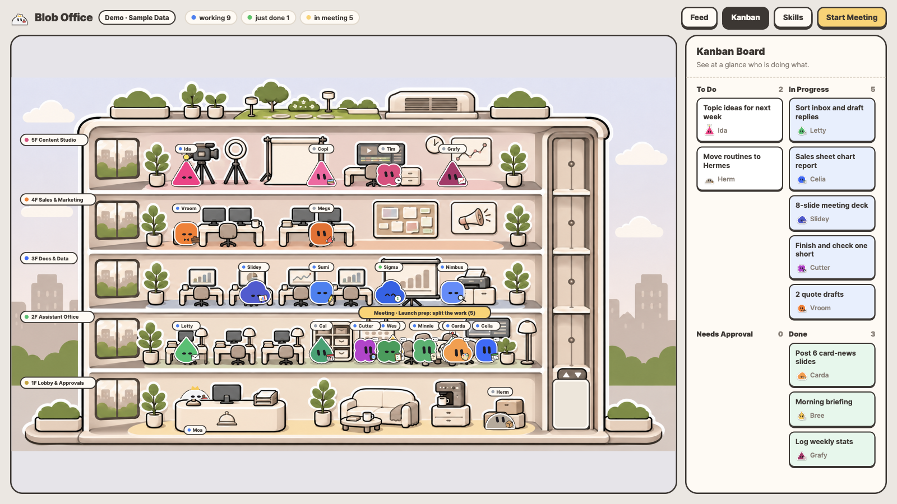
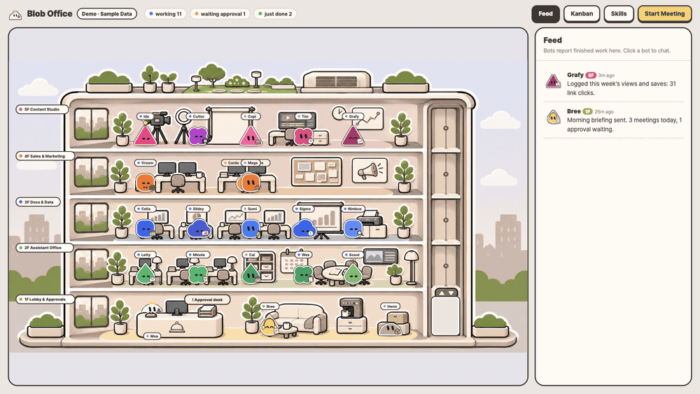
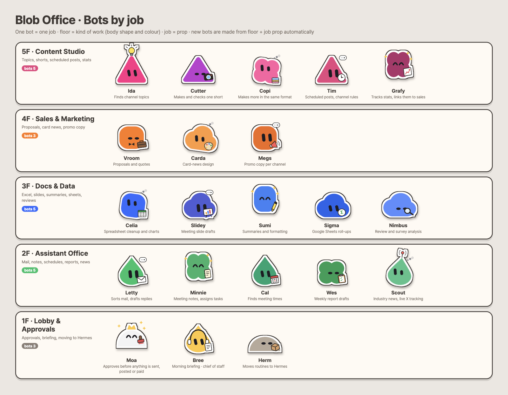

<p align="center"></p>

<p align="center"><b>English</b> · <a href="README.ko.md">한국어</a></p>

# Blob Office

Shows the [Hermes Agent](https://github.com/NousResearch/hermes-agent) bots on your computer as squishy blob coworkers in a building where every floor does a different kind of work.



- One profile is one bot. Its job decides its floor; each floor has its own body shapes and colours, and each job its own prop.
- Bots really walk around. When one needs approval it takes the elevator down to the 1F approval desk; when a meeting starts they gather at the 2F table.
- Click a bot to chat with it, and approve or deny its request right there.
- Feed, kanban board, and skills & tools by floor, all on one screen.

## Floors

| Floor | Work | Example bots |
|---|---|---|
| 5F Content Studio | topics, shorts/reels, scheduled posts, stats | Ida · Cutter · Copi · Tim · Grafy |
| 4F Sales & Marketing | proposals and quotes, card news, promo copy | Vroom · Carda · Megs |
| 3F Docs & Data | Excel and charts, slides, summaries, sheet roll-ups, review analysis | Celia · Slidey · Sumi · Sigma · Nimbus |
| 2F Assistant Office | mail, meeting notes, scheduling, weekly reports, industry news | Letty · Minnie · Cal · Wes · Scout |
| 1F Lobby & Approvals | approvals, morning briefing, moving to Hermes | Moa · Bree · Herm |



## 1. Try the demo (1 minute)

Requires [Node.js](https://nodejs.org) 20+.

```bash
git clone https://github.com/dingcodingco/hermes-blob-office
cd hermes-blob-office
npm run demo:en          # English bots and sample data
# npm run demo           # the same office in Korean
```

Open http://127.0.0.1:4300. The demo uses sample data and does not need Hermes; the top of the screen says "Demo · Sample Data". Bots finish work, pick up new work and now and then come down for approval on their own.

## 2. Connect your Hermes (no key)

On a computer with Hermes installed:

```bash
node bin/blob-office.js --hermes --config examples/en/office.config.json   # English
```

| On screen | Read from |
|---|---|
| Bots (profiles), on/off | `hermes profile list` |
| Kanban board | `hermes kanban list --json` |
| Skills | `hermes -p <profile> skills list` |

Every Hermes profile shows up as a bot. The office re-reads every 15 seconds.

## 3. Turn on chat (key required)

To chat and use the approval buttons, enable the Hermes API server. Create and enter the key yourself.

1. Make a key of 16+ characters: `openssl rand -hex 32`
2. Add to the end of `~/.hermes/.env`:
   ```bash
   API_SERVER_ENABLED=true
   API_SERVER_KEY=<key>
   ```
3. Restart the gateway: `hermes gateway restart`
4. Copy `.env.example` to `.env` in this folder and put the same key after `HERMES_API_KEY=`.
5. Run `node bin/blob-office.js --hermes` again. The badge should say "Hermes Connected".

For other profiles, add `API_SERVER_KEY` to `~/.hermes/profiles/<profile>/.env` and the same value as `HERMES_API_KEY_<PROFILE NAME IN CAPS>=` in this folder's `.env` ([docs](https://hermes-agent.nousresearch.com/docs/user-guide/features/api-server), "Multi-profile routing").

> With the API key, a bot can run terminal commands. Keep the key private and never commit `.env` (it is in `.gitignore`).

## 4. Names, floors and props

Add one line per profile to `agents` in `office.config.json`:

```json
{ "id": "card", "name": "Carda", "profile": "cardnews", "job": "Card-news design" }
```

- `profile` is the Hermes profile name.
- The floor comes from words in `job`, `name` and `profile` (e.g. "shorts"/"reels" → 5F, "quote"/"promo" → 4F, "excel"/"slide" → 3F, "mail"/"minutes" → 2F, "approve"/"brief" → 1F). Set it yourself with `"floor": "content" | "sales" | "oa" | "secretary" | "lobby"`.
- The prop also comes from job words (mail → envelope, excel → sheet, shorts → camera …), or set `"prop": "camera"`. All props are in `public/props.js`.
- Body shape and colour rotate through the floor's family; override with `"shape"` and `"color"`.
- Profiles not listed are added automatically. Turn that off with `"autoAddProfiles": false`.
- More than 6 bots on one floor opens building 2, 3…; switch with the buttons at the top.
- Add `"lang": "en"` for the English UI. Default is Korean (`"ko"`). [`examples/en/office.config.json`](examples/en/office.config.json) is a full English office; start from it, or run any config with `node bin/blob-office.js --config path/to/office.config.json`.

## 5. Meetings

In the demo, "Start Meeting" brings one bot from each floor up or down to the 2F meeting table; when it ends, new tasks appear on the kanban board.

In Hermes this is splitting one big task across several profiles:

```bash
hermes kanban create "Launch prep" --triage
hermes kanban decompose <task id>
```

Splitting calls an AI model once, so it uses a little quota.

## Good to know

- The Hermes connection is the same code as [Pawffice](https://github.com/dingcodingco/hermes-pawffice). Tested with Hermes v0.21.2.
- "Working" is exact only for tasks started from this screen. Hermes does not report run state for tasks started from Telegram or cron.
- Bots are drawn in code (SVG) in `public/bots.js` and `public/props.js`, not image files. The building background was made with AI image generation.
- Font: [Pretendard](https://github.com/orioncactus/pretendard) (OFL), loaded from the web.
- No dependencies. Run tests with `npm test`.

## Contributing

Bug reports, new props, new floors and translations are welcome. See [CONTRIBUTING.md](CONTRIBUTING.md).

## License

MIT
